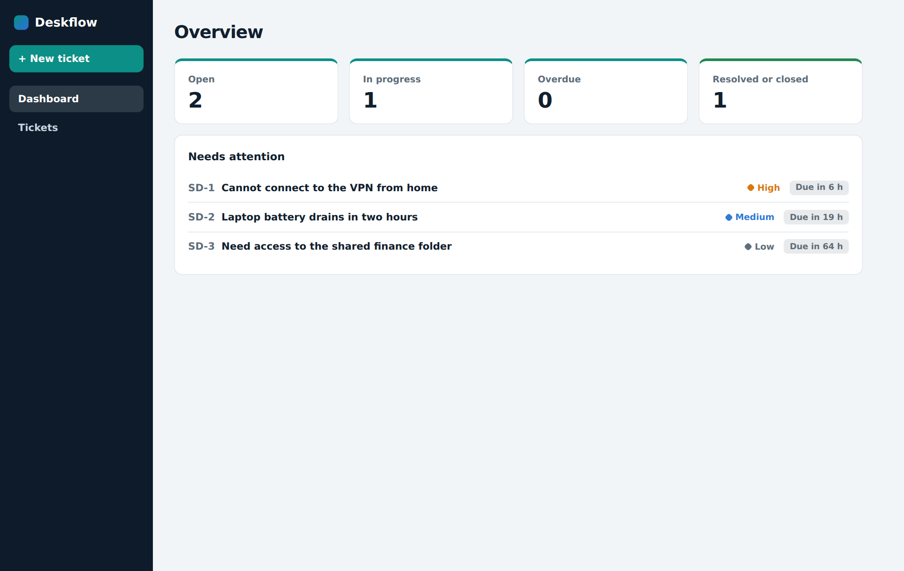
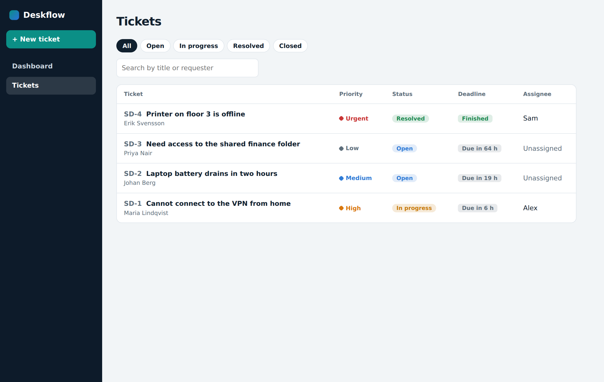

# Service Desk: Full-Stack Ticketing App

A full-stack service desk app: users raise tickets, the support team assigns, replies to and resolves them. React and TypeScript on the front, Spring Boot and an embedded H2 database on the back.

- `service-desk-frontend`: React and TypeScript web app
- `service-desk-backend`: Spring Boot REST API with an embedded H2 database

## Screenshots

## Run it

1. Open `service-desk-backend` in IntelliJ and run `ServiceDeskApplication` (port 8080).
2. In a second terminal:

   cd service-desk-frontend
   npm install
   npm run dev

3. Open http://localhost:5173